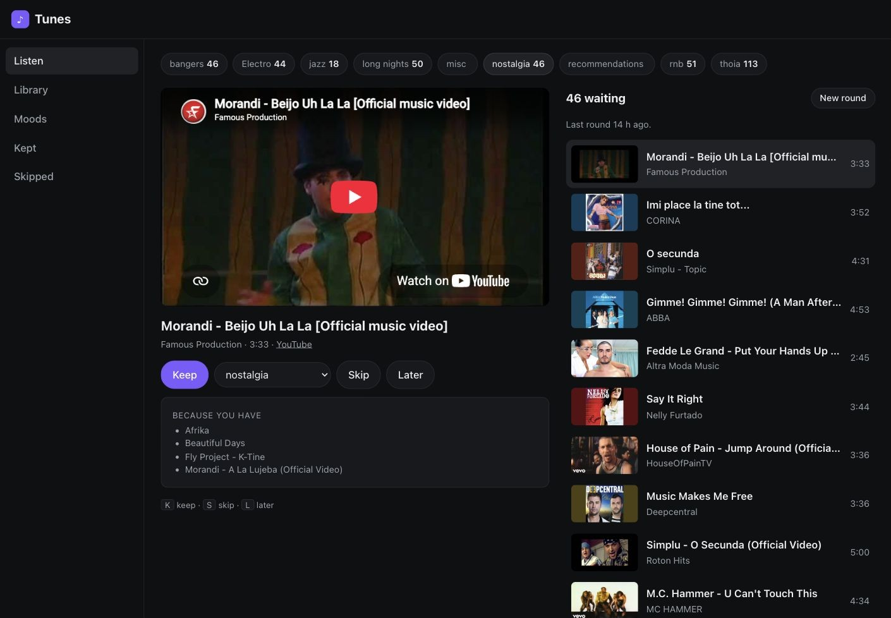
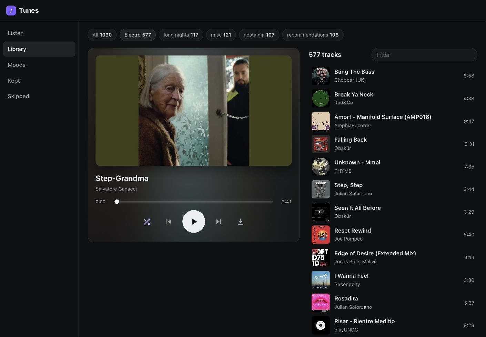
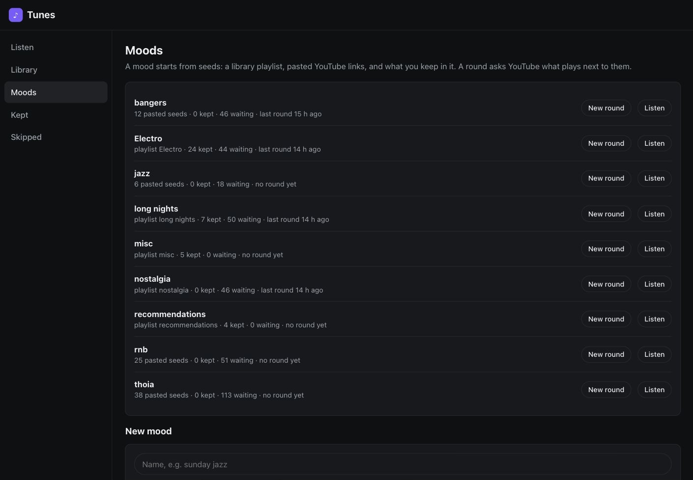

<div align="center">

# 🎧 Tunes

**A personal music recommender and player. Pick a mood, listen, press Keep or Skip.**

*YouTube's own radio as the source, a ranking you can read, one Python file on your own server.*

<br>



*`K` keep · `S` skip · `L` later. The box under the player names the seeds that led to this track.*

</div>

---

## Why this exists

Three honest reasons:

1. **I want to hear a track before it reaches my library.** A recommendation list is only a list of titles. Here every track plays first. Keep downloads it into a playlist folder. Skip means it is never offered again.
2. **I did not want a model or an account in the loop.** Every YouTube video has an auto-generated Mix, YouTube's own radio for that track. Tunes reads the Mix of each seed and ranks the tracks that several seeds agree on. The formula is short and it is written below. Each track shows the seeds that voted for it.
3. **It should run on a small home server.** The server is one Python file on the standard library, with one SQLite file for state. The only other tools are `yt-dlp` and `ffmpeg`. The web app is plain JavaScript with no build step.

<div align="center">


*The Library tab plays the music you already own, by playlist, with shuffle and a button that saves the track to this device.*
</div>

---

## What it does

| | |
|---|---|
| 🎚 **Moods** | A mood is a named set of seeds: a library playlist, pasted YouTube links, and the tracks you keep in that mood. Each mood has its own queue and its own default folder for Keep. |
| 🔁 **Rounds** | **New round** reads the YouTube Mix of each seed (up to `seeds_per_round`) and ranks the tracks that two or more seeds agree on. Rounds run in the background, one at a time. Mixes are cached, and each round samples the seeds in a new random order. |
| 👂 **Listen, then decide** | The queue plays in an embedded YouTube player, best track first. **Keep** downloads the audio into the playlist folder you pick. **Skip** removes the track for good. **Later** moves on with no verdict. Keys: `K`, `S`, `L`. |
| 💡 **Because you have** | Every track in the queue lists the seeds that recommended it, so you can see why it is there. |
| ⬇️ **Downloads** | Kept tracks download one at a time with `yt-dlp`, as m4a with metadata and cover embedded. A download is skipped when the disk has less than 5 GB free. The header shows how many downloads are running. |
| 📥 **Library import** | With `import_cmd` set, a **Send to Plex** button runs your import script for the downloaded tracks. With `auto_import_after` set, it runs by itself after downloads have been quiet for that many seconds. |
| 📚 **Library player** | Plays the music you already own (read from the beets database): by playlist or all of it, newest first, with shuffle, a filter box, cover art and seek. It answers to media keys. Keys: `N` next, `P` previous, `space` play or pause. One button saves the playing track to the device. |
| 🗂 **Kept and Skipped** | Two history pages. Kept shows the mood, the folder and the download state of each track. Skipped has a **Back to queue** button for each track. A channel with only skips is ranked lower. |
| ⚙️ **Settings on the server** | The last mood, the last playlist and shuffle are kept in `data/settings.json` on the server, so every device opens the same way. Only the token stays in the browser. |
| 📱 **Installable** | A web manifest and a service worker keep the app shell available, so the installed app opens at once (the service worker needs HTTPS or localhost). The API, audio and covers are never cached. |

<div align="center">


*The Moods tab: where each mood gets its seeds, how many tracks wait, and when the last round ran.*
</div>

---

## Run

No dependencies beyond Python 3.11, `yt-dlp` and `ffmpeg`. No build step. A Docker image is included.

```sh
cp server/tunes.example.json server/tunes.json   # set a token and the paths
python3 server/tunes.py
```

Open `http://localhost:8792` and paste the token.

## Config (`server/tunes.json`, never committed)

| Key | Meaning |
|---|---|
| `token` | Bearer token the web app sends |
| `port` | Default 8792 |
| `data_dir` | Where `state.db` lives |
| `music_dir` | Kept tracks land in `<music_dir>/<folder>` |
| `folders` | Playlist folders you can keep into |
| `beets_db`, `pinchflat_db` | Read only. Used for "already owned" and playlist seeds |
| `library_dir` | Where the library's audio files are on this machine. Without it the Library tab lists tracks but cannot play them |
| `beets_dir` | The folder beets believes the library is in, for absolute paths in its DB (default `/music`) |
| `seeds_per_round` | Seeds sampled per round (default 40) |
| `queue_size` | Tracks kept per round (default 50) |
| `ytdlp` | The yt-dlp command (default `["yt-dlp"]`). It can be another container's copy: `["docker", "exec", "pinchflat", "yt-dlp"]` |
| `ytdlp_music_dir` | `music_dir` as that yt-dlp sees it, when it runs in a container |
| `download_owner` | Optional `[uid, gid]` for downloaded files |
| `import_cmd` | Optional command behind the "Send to Plex" button |
| `auto_import_after` | Optional. Run `import_cmd` by itself once downloads have been quiet this many seconds |

## Docker (homelab)

```sh
docker compose up -d --build
```

- The image carries its own `yt-dlp`, `ffmpeg` and `deno`. yt-dlp updates at start and once a day.
- Host folders are mounted at the same paths, so `tunes.json` uses host paths.
- The import script runs inside the container and reaches beets through the Docker socket.

## Ranking

- Each seed's mix gives a track `1 / (1 + position * 0.15)`.
- Rank is the mean per seed, times `1 + 0.25 * sqrt(seeds - 1)`.
- A track needs two seeds behind it. Channels you only ever skipped count 0.4.
- With 12 or more seeds, a track recommended by over 25% of them is dropped as generic filler.
- Another upload of a seed's own song (lyrics video, reupload) is dropped.
- Owned, kept and skipped tracks never come back.

## Old recommender data

```sh
python3 server/tunes.py --import /path/to/music-tools/data
```

Loads verdicts, the download ledger, the mix cache, seed files and suggestion lists. Safe to run twice. It never writes back to the old files.

## Tests

```sh
python3 -m unittest discover -s tests
```
